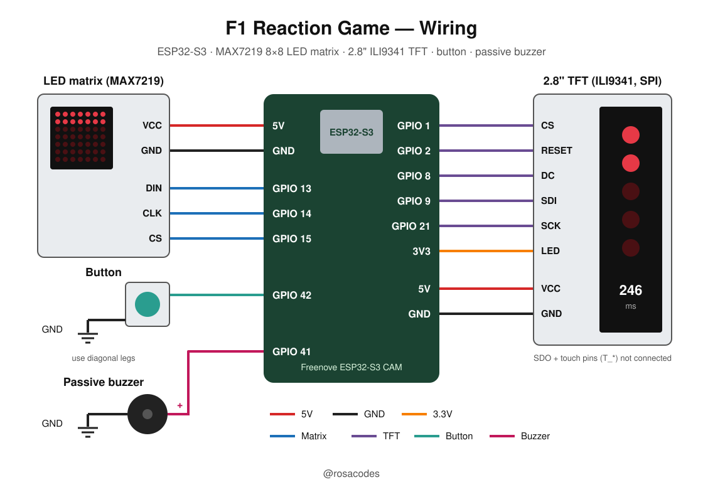

# 🏎️ F1 Reaction Game

An F1 start-lights reaction game built with an ESP32-S3. Five red lights come on one by one, then go out after a random delay — hit the button as fast as you can. Press too early and it's a jump start.

Built for the Las Vegas Grand Prix weekend to answer one question: am I faster than an F1 driver? (They're around 200 ms.)

## Parts

- ESP32-S3 (Freenove ESP32-S3 CAM)
- 8×8 LED matrix with MAX7219 driver
- 2.8" TFT display, SPI, 240×320 (ILI9341)
- Push button
- Passive buzzer

## Wiring

| Part | Pin | ESP32-S3 |
|---|---|---|
| LED matrix | VCC / GND | 5V / GND |
| | DIN / CLK / CS | 13 / 14 / 15 |
| TFT | VCC / GND | 5V / GND |
| | CS / RESET / DC | 1 / 2 / 8 |
| | SDI / SCK | 9 / 21 |
| | LED | 3V3 |
| Button | diagonal legs | 42 / GND |
| Buzzer | + / − | 41 / GND |

The TFT's SDO and touch pins (T_*) are not connected.

## Setup

1. Install the ESP32 boards package in the Arduino IDE.
2. Install **Adafruit ILI9341** from the Library Manager (click *Install All* for the dependencies).
3. Select **ESP32S3 Dev Module** as the board.
4. Open `f1_reaction/f1_reaction.ino` and upload.

## How to play

1. Press the button to start.
2. Five lights come on, one per second.
3. After a random delay, all lights go out — press as fast as you can.
4. Your time shows on the TFT and scrolls across the LED matrix.

## Tweaks

- `TFT_ROT`: set to `3` if the screen is upside down
- `TIME_ROT`: rotation of the scrolling time on the matrix (`0`, `1` or `3`)
- `MIRROR`: set to `true` if the matrix image is mirrored
- `BRIGHTNESS`: matrix brightness, `0`–`15`

Made by [@rosacodes](https://instagram.com/rosacodes)
